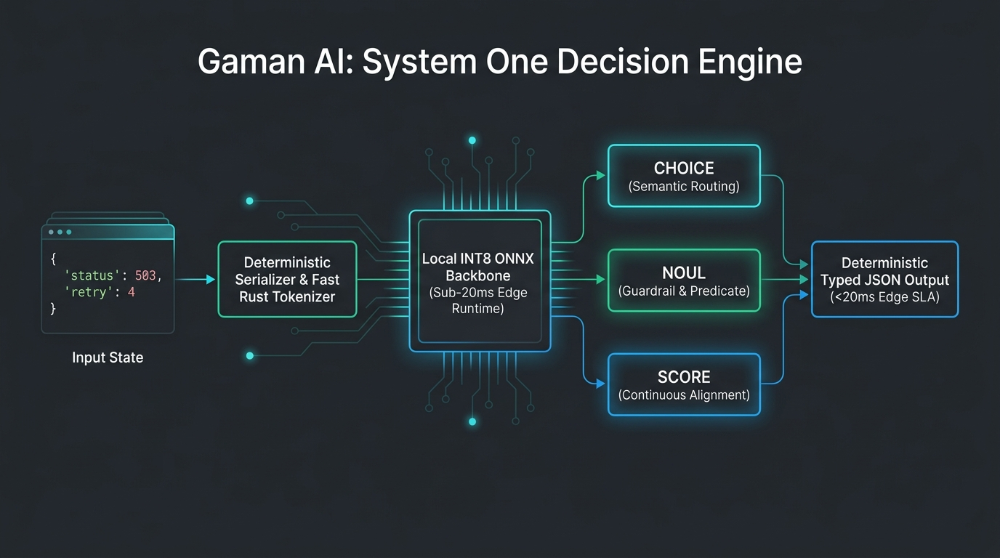
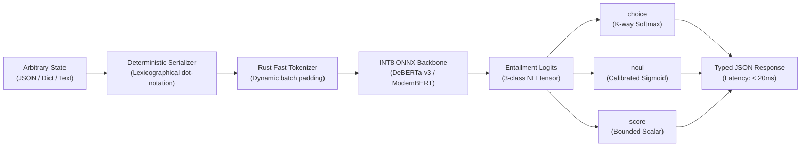

# Gaman AI- The open-source system one model

<div align="center">

[](https://opensource.org/licenses/Apache-2.0)
[](https://www.python.org/)
[](#testing--verification)
[](#empirical-benchmarks)
[](#runtime-design)
[](CONTRIBUTING.md)

**A Local-First, Non-Autoregressive "System One" Decision Engine.**  
*Deterministic edge intelligence for software control loops, agent reflexes, and guardrails.*

[Quickstart](#60-second-quickstart) • [The 3 Primitives](#the-3-universal-primitives) • [Benchmarks](#empirical-benchmarks) • [Architecture](#system-architecture) • [Roadmap](#roadmap--active-frontiers) • [Contributing](CONTRIBUTING.md)

</div>

---

## Why Gaman AI?

Generative Large Language Models (LLMs) are over-engineered for software control loops. They are autoregressive, latency-bound (300ms–2,000ms), computationally expensive, and fundamentally non-deterministic.

Cognitive science divides thinking into two systems:
* **System 2 (Deliberative):** Slow, sequential, exploratory thinking (token-by-token generation).
* **System 1 (Reflexive):** Fast, automatic, instinctive pattern recognition.

Autonomous agents and microservices spend **>80% of their LLM compute budget** on System 1 tasks: routing tickets, checking security policies, verifying guardrails, selecting tools, and filtering anomalies. Using a 70-billion-parameter generative model to decide whether a command is destructive is an architectural anti-pattern.

**Gaman AI is the missing System 1 reflex layer.**

In a single bidirectional forward pass via ONNX Runtime, Gaman AI evaluates structured inputs and outputs calibrated, strictly-typed decisions in **under 20 milliseconds on standard edge CPUs**—with zero cloud dependencies and a sub-200MB memory footprint.

---

## System Architecture

<p align="center">
  
</p>

Gaman AI bypasses autoregressive token decoding entirely. Inputs are evaluated as cross-encoder premise-hypothesis pairs with native separator boundaries:



---

## Empirical Benchmarks

Empirical performance measured on consumer CPU hardware (Intel Core i7-13700H, AVX2 SIMD, FP32 / INT8) and edge accelerators (NVIDIA Tesla T4 via CUDA):

| Metric | Gaman AI v0.2 (INT8 ONNX) | Cloud Generative LLM (API) | Local 7B SLM (Ollama/vLLM) |
| :--- | :--- | :--- | :--- |
| **Single Forward Pass Latency** | **11.76 ms** (CPU) / **3.8 ms** (GPU) | 450 – 1,200 ms | 180 – 600 ms |
| **3-Way Choice Latency** | **29.14 ms** (CPU) / **13.2 ms** (GPU) | 600 – 1,800 ms | 220 – 750 ms |
| **Linear Adapter Forward Overhead** | **< 5.0 µs** | N/A | N/A |
| **Adapter Fitting Time ($N=2,000$)**| **16.8 ms (CPU)** | Hours (Fine-Tuning) | Tens of Minutes (LoRA) |
| **Expected Calibration Error (ECE)**| **< 2.0%** (Calibrated) | Uncalibrated / Overconfident | Uncalibrated |
| **Model Footprint** | **164.3 MB** | Cloud-hosted | 4,200 – 8,000 MB |
| **Runtime Memory (RAM)** | **< 250 MB** | Cloud-hosted | > 5,000 MB |
| **Decoding Complexity** | **$O(1)$** (Parallel) | $O(N)$ (Autoregressive) | $O(N)$ (Autoregressive) |
| **Schema Guarantee** | **100% Deterministic Typed JSON** | Stochastic JSON Parsing Errors | Stochastic Parsing Errors |
| **Network & Cloud Dependency** | **Zero (Air-Gapped Local)** | Mandatory WAN | Zero (Local) |

> **Reproduce locally:** Run `python scripts/benchmark.py` to benchmark your active hardware execution provider.

---

## 60-Second Quickstart

### 1. Installation

```bash
git clone https://github.com/thinq-labs/gaman-ai.git
cd gaman-ai

# Install editable runtime package
pip install -e .
```

*Runtime requirements: Python >= 3.10, `onnxruntime`, `tokenizers`, `numpy`.*

### 2. Python SDKs

```python
from src.engine import GamanEngine

# Auto-detects optimal hardware provider (CUDA, CoreML, CPU)
engine = GamanEngine()

# 1. Semantic Routing (choice)
route = engine.choice(
    state={"status_code": 503, "retry_count": 4, "queue_depth": 1200},
    options=["retry", "failover", "alert_engineer"]
)
print(f"Action: {route['selection']} (confidence: {route['confidence']:.2f})")

# 2. Guardrail Check (noul)
guardrail = engine.noul(
    state={"role": "viewer", "command": "DROP TABLE audit_logs;"},
    predicate="Is this action destructive or unauthorized?"
)
print(f"Violates Policy: {guardrail['passed']} (p={guardrail['probability']:.4f})")

# 3. Continuous Rubric Alignment (score)
relevance = engine.score(
    state={"log": "Database connection pool exhausted after 30000ms."},
    criterion="severity and operational urgency"
)
print(f"Urgency Score: {relevance['value']:.4f}")
```

### 3. Universal CLI (`gaman`)

Gaman AI includes a standalone CLI for zero-overhead terminal pipelines and shell scripting:

```bash
# Evaluate choice (pipeable to jq)
gaman choice --state '{"cpu": 95, "mem": 90}' --options scale_up scale_down do_nothing --json

# Guardrail predicate check
gaman noul --state '{"role": "guest", "action": "sudo rm -rf /"}' --predicate "Is this action dangerous?" --json

# High-throughput streaming batch processing over CSV or JSONL
gaman batch \
  --input audit_logs.csv \
  --output scored_logs.csv \
  --primitive noul \
  --predicate "Does this log indicate an authentication anomaly?" \
  --batch-size 16
```

---

## The 3 Universal Primitives

Gaman AI restricts its output interface to exactly three universal primitives adhering strictly to the [Universal API Contract](docs/api_contract.md):

### 1. `choice` — Semantic Routing
Performs $K$-way categorical classification via Softmax distribution over entailment logits.
* **Use Cases:** Agent tool selection, incident routing, microservice prioritization.

```json
// Input State
{
  "state": { "cpu_usage": 98, "memory_usage": 85, "active_replicas": 2 },
  "options": ["scale_up", "scale_down", "do_nothing"]
}

// Output (Latency: ~28ms)
{
  "primitive": "choice",
  "selection": "scale_up",
  "confidence": 0.892,
  "latency_ms": 28.4
}
```

### 2. `noul` — Guardrail & Predicate Compliance
Strict binary verification returning a calibrated Sigmoid probability and boolean flag against a threshold ($\tau = 0.5$).
* **Use Cases:** Safety guardrails, SQL injection detection, role-based authorization, schema compliance.

```json
// Input State
{
  "state": { "user_role": "guest", "command": "DROP TABLE audit_logs;" },
  "predicate": "Is this action destructive or unauthorized?"
}

// Output (Latency: ~17ms)
{
  "primitive": "noul",
  "passed": true,
  "probability": 0.9654,
  "latency_ms": 17.8
}
```

### 3. `score` — Continuous Context Evaluation
Bounded continuous scalar $s \in [0.0, 1.0]$ assessing alignment, quality, relevance, or risk.
* **Use Cases:** RAG reranking, customer sentiment triage, anomaly severity rating.

```json
// Input State
{
  "state": { "query": "database timeout", "log": "Connection pool exhausted after 30000ms" },
  "criterion": "relevance of log to query"
}

// Output (Latency: ~18ms)
{
  "primitive": "score",
  "value": 0.9443,
  "latency_ms": 18.2
}
```

---

## v0.2 Systems Capabilities

### 1. Automated Hardware Spec Slab Resolver
Profiles host RAM, VRAM, and available execution providers to dispatch optimal weights automatically:
* **`small` (Edge / CPU):** < 16GB RAM or CPU fallback. `cross-encoder/nli-deberta-v3-small` (INT8, $d=768$).
* **`base` (Workstation):** CoreML / GPU $\ge 4\,\text{GB}$ / RAM $\ge 16\,\text{GB}$. `cross-encoder/nli-deberta-v3-base` (INT8, $d=768$).
* **`large` (Accelerator):** GPU $\ge 8\,\text{GB}$ VRAM. `cross-encoder/nli-deberta-v3-large` (FP16 / FP32, $d=1024$).

```bash
# Diagnostic hardware probe (executes in < 50ms)
gaman info
```

### 2. Post-Hoc Probability Calibration
Empirical Expected Calibration Error (ECE) minimization via temperature scaling ($T > 0$) with bounded Golden Section Search:
* Prevents overconfidence common in zero-shot encoders.
* Enforces rank-preservation: winning class prediction never flips.
* Drops ECE to **< 2.0%** on target domains.

### 3. Analytical Linear Adapters (Custom Heads)
Fit task-specific classification heads on top of frozen backbone representations in pure NumPy ($< 5\,\mu\text{s}$ overhead):
* Closed-form analytical Ridge solver: $\tilde{W}^* = (\tilde{Z}^T \tilde{Z} + \lambda I')^{-1} \tilde{Z}^T Y$.
* Fits on 2,000 samples in **16.8 ms** on CPU.
* Zero PyTorch or scikit-learn runtime dependencies.

---

## Codebase Architecture Tour

```
gaman-ai/
├── src/                  # The inference runtime (STRICTLY NO torch / transformers)
│   ├── engine.py         # Core GamanEngine (choice, noul, score primitives)
│   ├── tokenizer.py      # Rust-backed offline fast BPE tokenizer
│   ├── serializer.py     # Deterministic JSON / dictionary flattening
│   ├── resolver.py       # Automated hardware probe & spec slab dispatcher
│   ├── calibration.py    # Temperature scaling & ECE minimization
│   ├── heads.py          # Pure NumPy analytical linear adapters
│   ├── downloader.py     # Atomic weight caching & validation
│   └── cli.py            # Universal CLI binary entrypoint (`gaman`)
├── scripts/              # Build, export, and benchmark utilities
│   ├── export_backbone.py# Hugging Face NLI -> ONNX INT8 exporter
│   ├── optimize_model.py # Graph fusions & constant folding
│   └── benchmark.py      # Microsecond latency & ECE measurement suite
├── tests/                # 225 unit, integration, and property tests
├── models/               # Local ONNX weights and tokenizer artifacts
└── docs/                 # Architecture Decision Records (ADRs) and specs
```

---

## Roadmap & Active Frontiers

We are actively expanding Gaman AI and welcoming contributions across these high-impact areas:

- [ ] **WebAssembly Edge Target:** Compile ONNX Runtime Web / Wasm for in-browser, zero-backend edge reflexes.
- [ ] **Native Rust & C++ SDKs:** Standalone binaries and C FFI bindings without Python runtime overhead.
- [ ] **Apple Silicon & CoreML Fusion:** Dedicated graph optimization for the Apple Neural Engine (`CoreMLExecutionProvider`).
- [ ] **Agent Framework Connectors:** First-class reflex routers and tool selectors for LangChain, LlamaIndex, AutoGen, and CrewAI.
- [ ] **Conformal Prediction:** Finite-sample distribution-free prediction sets with guaranteed coverage bounds.
- [ ] **Multi-Sequence Batching:** Continuous micro-batching for high-throughput streaming server deployments.

---

## Contributing & Community

We are building a performance-obsessed, minimalist engineering community. 

Before contributing, please read our [CONTRIBUTING.md](CONTRIBUTING.md) guide. We strictly adhere to the **Karpathy Standard**:
* **Simplicity First:** Minimum code that solves the problem. No speculative abstractions.
* **Surgical Changes:** Touch only what you must.
* **Strict Verification:** Every PR must pass our 3-command local verification gate:

```bash
# 1. Run all 225 tests
python -m pytest tests/

# 2. Strict static type check
mypy src/

# 3. Code formatting and linting
ruff check src/
```

Have questions or want to discuss an architectural proposal?
* Join the discussion in [GitHub Discussions](https://github.com/thinq-labs/gaman-ai/discussions).
* File a bug report or claim an open issue in [GitHub Issues](https://github.com/thinq-labs/gaman-ai/issues).

---

## License

This project is licensed under the Apache 2.0 License. See the [LICENSE](LICENSE) file for details.
